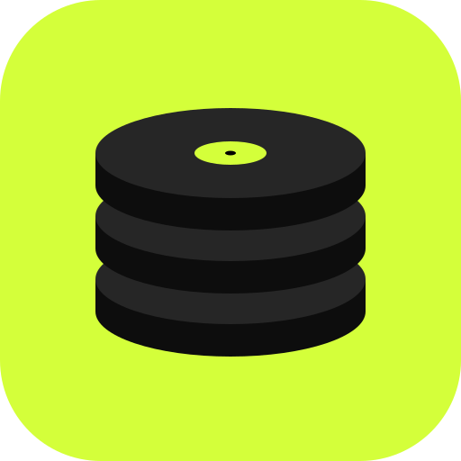
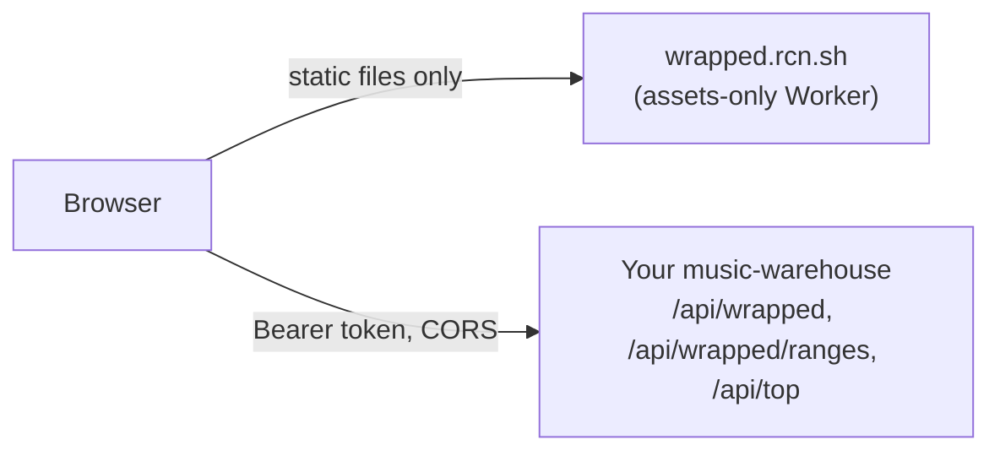

<div align="center">

<h1>music-warehouse-wrapped</h1>
<p><strong>Spotify-Wrapped-style stories from your own listening history, for any year or range.</strong></p>
<p>
<a href="LICENSE"></a>

<a href="https://wrapped.rcn.sh"></a>
<a href="https://github.com/rcnsh/music-warehouse#clients"></a>
</p>
<p><a href="https://wrapped.rcn.sh"><strong>Open the app</strong></a> · <a href="#quick-start">Quick start</a> · <a href="#whats-in-a-story">What's in a story</a> · <a href="#self-hosting">Self-hosting</a> · <a href="#development">Development</a> · <a href="#related-projects">Related projects</a></p>
</div>

Spotify Wrapped covers one year, cut off in the autumn, from Spotify's own data.
This app builds the same kind of story from the history your
[music-warehouse](https://github.com/rcnsh/music-warehouse) Worker has recorded,
for any year or range you pick. It plays in the browser and can be exported as
an MP4 video or a PNG share card. It is a static site: your browser talks to
your warehouse directly, so the app itself holds no credentials and no data.

> [!NOTE]
> This app needs your own [music-warehouse](https://github.com/rcnsh/music-warehouse)
> deployment. If you don't have one yet, start with its
> [quick start](https://github.com/rcnsh/music-warehouse#quick-start).

## Features

- **Any range.** Each year with plays, this year so far, the last 30 or 90
  days, all time, or any custom pair of dates.
- **A full story.** Up to 14 animated slides at 1080 × 1920, built with
  [Remotion](https://www.remotion.dev). Slides the data can't support are
  skipped. See [What's in a story](#whats-in-a-story).
- **Your own soundtrack.** Pick a local audio file and the app finds its most
  energetic stretch (the "hook") and plays the story over it.
- **Export in the browser.** Render the story to an MP4, or the summary slide to
  a PNG card. Nothing is uploaded.
- **Sign in with Spotify** through your warehouse, or paste a token.

## What's in a story

Slides appear in this order. Each is shown only when the range has the data
for it.

| Slide | What it shows | Shown when |
|---|---|---|
| Intro | The range's title over a spinning disc of your top song's art | Always |
| Minutes | Minutes listened, counted up, and how many whole days that makes | Any minutes played |
| Listening clock | Plays by hour as a turntable, a listener persona and your peak hour | Any plays by hour |
| Top artist tease | "Your top artist", zooming in line by line | At least one artist |
| Top artist | Photo, minutes, share of all listening, days played, longest run of days | At least one artist |
| Top artists | Your top five, ranked, with photos | At least three artists |
| Top song | Art, play count and the month it peaked | At least one song |
| Top songs | Your top five with plays, over a carousel of their art | At least three songs |
| Top album | Art, songs played from it and minutes | At least one album |
| Listening age | The age your listening suggests, its release window and the main decades | The warehouse returns one |
| Discoveries | New artists and songs, and your biggest find | New artists, under 90% of the total |
| Mixtape | Each month's top artist and song, up to 12 months | At least three months |
| Streak | Your longest run of consecutive days, with dates | Three days or more |
| Summary | Top five artists and songs, minutes, and listening age or top album | At least one artist |

Artist photos come from Spotify's live top-artist lists via the warehouse's
`/api/top`. Artists outside those lists use the art of their top song.

## How it works



- The site is an assets-only Cloudflare Worker with no bindings, secrets or
  server code. It serves HTML, JavaScript and CSS, nothing else.
- The browser calls the warehouse URL you enter, sending your token as a
  `Bearer` header. The warehouse URL must use HTTPS (plain HTTP is allowed for
  `localhost` and `127.0.0.1` only).
- `GET /api/wrapped/ranges` lists the warehouse's presets and checks the URL and
  token; `GET /api/wrapped?from=…&to=…` returns the story's data. If the
  warehouse answers 503 while it computes a range, the app waits for the
  `Retry-After` time and asks again.
- Video and card exports are rendered in the browser with Remotion's web
  renderer and encoded with WebCodecs via [Mediabunny](https://mediabunny.dev).

### Privacy

- A sign-in token and the warehouse URL are kept in the tab's `sessionStorage`
  only, so closing the tab forgets them; a pasted token is kept in memory only.
  **Use a different warehouse** clears them.
- Artist photo URLs are cached in `localStorage` for up to seven days, tied to
  the warehouse URL, and cleared when you switch warehouse.
- A soundtrack file is decoded locally and never leaves your machine.
- The hosted site has no analytics and no backend; it cannot see your history
  or your token. The only other requests are for fonts (Google Fonts, via
  `@remotion/google-fonts`) and cover art and artist photos (Spotify's image
  CDN).
- The site sends a Content-Security-Policy and related headers from
  [`public/_headers`](public/_headers): scripts from the site only, no `eval`
  (WebAssembly aside, for the audio encoders), no framing, no referrer.
  `connect-src` has to allow any HTTPS origin, since the warehouse is whichever
  one you enter.

## Requirements

- A deployed [music-warehouse](https://github.com/rcnsh/music-warehouse) Worker
  that serves `/api/wrapped` and `/api/wrapped/ranges`.
- This app's origin in the warehouse's `CORS_ORIGINS`: `https://wrapped.rcn.sh`
  for the hosted site, your own domain if you self-host, or
  `http://localhost:5173` for development. See the warehouse's
  [configuration](https://github.com/rcnsh/music-warehouse#configuration).
- Optional: [Spotify sign-in](https://github.com/rcnsh/music-warehouse#signing-in-with-spotify)
  set up on the warehouse, if you want to sign in rather than paste a token.
- A recent desktop browser. Video export needs WebCodecs and WebGL; the app
  checks for them first, exports WebM where the browser can't encode H.264, and
  says so if it can't export video at all.

> [!IMPORTANT]
> If the warehouse doesn't list this app's origin in `CORS_ORIGINS`, the browser
> blocks every request and the app reports that it couldn't reach the warehouse.

## Quick start

Using the hosted site at <https://wrapped.rcn.sh>:

1. Add `https://wrapped.rcn.sh` to your warehouse's `CORS_ORIGINS` and deploy
   the warehouse.
2. Open <https://wrapped.rcn.sh> and enter your warehouse URL, for example
   `https://music-warehouse.<you>.workers.dev`.
3. **Sign in with Spotify** (the warehouse mints a 90-day read token), or paste
   a read [device token](https://github.com/rcnsh/music-warehouse#device-tokens).
4. Pick a range, or enter your own dates and choose **Wrap it**.
5. Play the story, optionally with a soundtrack from a local audio file, or
   export it as a video or a card.

### Which token to use

A read token: the one Spotify sign-in mints, or a device token minted with
`access: read`. It opens each year with plays, this year so far (the warehouse
computes these on request, and warms them from its daily cron), and any other
range the warehouse has already wrapped. The app offers only those ranges once
it knows the token is read-only.

> [!WARNING]
> Never paste the warehouse's `ADMIN_TOKEN` into this app, or any web page. It
> can mint and revoke tokens, and a public page is the wrong place to hold it.
> To wrap a custom range, ask for it once from a trusted machine (for example
> `curl -H "Authorization: Bearer $ADMIN_TOKEN" "$WORKER_URL/api/wrapped?from=…&to=…"`);
> after that the warehouse has it stored, and a read token can open it here.

A token from Spotify sign-in is kept in the tab's `sessionStorage`. A pasted
token is kept in memory only, so reloading the page asks for it again: the app
can't tell a read token from an admin one without spending a compute, so it
doesn't write any pasted token down.

## Self-hosting

The app is a static build deployed as an assets-only Worker with the
[`cf`](https://www.npmjs.com/package/cf) CLI.

1. Clone the repo and install dependencies:

   ```bash
   git clone https://github.com/rcnsh/music-warehouse-wrapped.git
   cd music-warehouse-wrapped
   npm install
   ```

2. In `cloudflare.config.ts`, change `domains` to a domain on your Cloudflare
   account (for example `['wrapped.example.com']`). The `workers.dev` and
   preview URLs are off, so the custom domain is the only address.
3. Build and deploy:

   ```bash
   npm run build && npm run deploy
   ```

4. Add your domain's origin (for example `https://wrapped.example.com`) to your
   warehouse's `CORS_ORIGINS`, and deploy the warehouse.

## Configuration

There is no runtime configuration: the warehouse URL and token are entered in
the browser. The only settings are in `cloudflare.config.ts`.

| Setting | Value | Notes |
|---|---|---|
| `name` | `music-warehouse-wrapped` | Worker name |
| `domains` | `['wrapped.rcn.sh']` | Change this when self-hosting |
| `workersDev` / `previewUrls` | `false` | Only the custom domain is public |
| `assets.notFoundHandling` | `single-page-application` | Unknown paths serve the app |

Response headers (the Content-Security-Policy and friends) are in
`public/_headers`, which Vite copies into the build and Workers static assets
applies to every response.

## Development

```bash
npm install
npm run dev          # Vite on http://localhost:5173
```

Open `http://localhost:5173/?fixture` to load the made-up sample in
`src/remotion/fixture.json` (fictional artists) with no warehouse at all; this
only works in the dev server. Against a real warehouse, run it locally with
`CORS_ORIGINS` set to `http://localhost:5173`.

| Script | What it does |
|---|---|
| `npm run dev` | Vite dev server on port 5173 |
| `npm run studio` | Remotion Studio, for working on slides |
| `npm run render` | Render the fixture to `out/wrapped.mp4` |
| `node scripts/stills.mjs [props.json]` | One still per slide to `out/stills` |
| `npm test` / `npm run typecheck` | Vitest / `tsc -b` |
| `npm run build && npm run deploy` | Build and deploy with `cf` (edit `domains` in `cloudflare.config.ts` first) |

<details>
<summary>Project layout</summary>

| Path | Contents |
|---|---|
| `src/app/` | The web app: connection and API calls, sign-in, range picker, player, soundtrack and export |
| `src/remotion/` | The Remotion composition: slide order in `timeline.ts`, slides in `slides/`, shared pieces in `ui/` and `three/` |
| `src/types.ts` | Mirrors the body of the warehouse's `GET /api/wrapped` |
| `scripts/stills.mjs` | Renders one still per slide |
| `cloudflare.config.ts` | Worker settings for `cf deploy` |

</details>

`src/types.ts` mirrors the body of the warehouse's `GET /api/wrapped`; update
it when that response changes.

## Related projects

| Repo | What it is |
|---|---|
| [music-warehouse](https://github.com/rcnsh/music-warehouse) | The Worker: records your plays and serves the API |
| [music-warehouse-gui](https://github.com/rcnsh/music-warehouse-gui) | Native macOS app for browsing your history |
| [music-warehouse-mcp](https://github.com/rcnsh/music-warehouse-mcp) | MCP server so AI agents can query your history |
| [music-warehouse-spicetify](https://github.com/rcnsh/music-warehouse-spicetify) | Stats inside the Spotify desktop client |
| [music-warehouse-wrapped](https://github.com/rcnsh/music-warehouse-wrapped) (this repo) | Wrapped-style stories for any range, in the browser |

## Licence

MIT. See [LICENSE](LICENSE).
